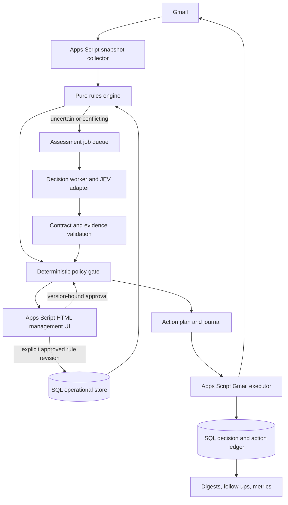

# Focuna v2 architecture

Status: target design, not running software. See [decisions](decisions.md) for
assumptions and [roadmap](roadmap.md) for dependency order.

## Goals and continuity

Preserve v1 outcomes: rules-first explainable sorting, structural plus workflow
labels, important-mail visibility, commercial archiving under controlled policy,
separate news, morning/evening main/news digests, conservative follow-ups,
draft-only reply assistance, operator-approved learning, and operational history.

V2 adds a shared decision contract, JEV assessment, explicit policy gates,
replayable evidence, idempotent actions, and measured rather than assumed AI quality.
It does not add autonomous sending, deletion, or autonomous rule learning.

## Component model

### 1. Pure domain core

Recommended language: TypeScript, compiled for Apps Script V8 and the worker.
Domain code must not import Gmail, Sheets, Node-only libraries, or network clients.
Functions transform normalized snapshots plus immutable configuration revisions
into rule results, assessments, policy decisions, and action plans.

Separate structural categories from workflow intent. Use stable internal enums,
mapping to existing Gmail label names only at the executor boundary.
Rule matching uses parsed sender addresses and exact/domain-boundary matching,
not arbitrary substrings across sender and subject. Explicit precedence:
manual/preserve constraints -> approved exact sender rules -> approved domain
rules -> content heuristics -> ambiguous fallback. Reject conflicting approved
rules at import instead of silently choosing spreadsheet order.

### 2. Google adapter and operator control

Retain Apps Script as the only Gmail reader/writer and scheduler. Provide an Apps
Script HTML Service management page. Its server-side handlers call the authenticated
worker API; browser code never has database or provider credentials. The worker API
owns SQL persistence for configuration revisions, approvals, recommendation state,
action journal, assessment jobs/results, and run history. Read one immutable config
revision per run; no mid-run mutable global config. UI edits are drafts until
validated and published as a revision.

Snapshot each thread using latest inbound/outbound meaningful-message context,
message IDs/timestamps, existing labels, and bounded excerpts. Treat message bodies,
subjects, display names, and quoted text as untrusted. Do not fetch attachments or
follow links for decisioning. Snapshot fingerprint changes invalidate stale proposals.

### 3. JEV decision worker

Preferred topology: small TypeScript/Node worker with a JEV provider adapter,
authenticated API, and durable SQL storage, hosted initially on the existing
`claw01` VPS (ADR-006). Start with SQLite on a verified persistent volume and one
active instance; keep a repository boundary for possible PostgreSQL migration.
Use an isolated service user/path and avoid interference with existing VPS
workloads. The worker receives minimized snapshots, rule evidence, and policy
definitions; it has no Gmail credentials. Use transactional job leases and unique
job keys; do not scale replicas against separate SQLite files.

Apps Script submits jobs, reads/writes operational records through the worker API,
and polls results in later bounded runs rather than holding its execution open for
model calls. The worker exposes authenticated HTTPS endpoints. Apps Script cannot
reach a localhost or private VPN endpoint directly: V2-P0 must confirm an approved
reachable ingress.
If that topology cannot be provided, revise the ADR before implementation;
do not expose an unauthenticated bridge or assume an agent-session tool is an API.

Apps Script must reach the API over an approved HTTPS ingress; the private
`10.8.0.1` VPN address is not assumed reachable from Google Apps Script. Before
deployment, validate host capacity, firewall and ingress scope, persistent storage,
backup/restore, monitoring, and rollback. Wire-level request/response signing,
canonicalization, replay-store semantics, key rotation, and endpoint definitions
are specified in [`worker-api.md`](worker-api.md) (ADR-007). Keys live in Script
Properties / worker secret storage, never Sheets, browser code, SQLite, or Git.
Human approval identity is distinct from integration-key authentication; approval
routes remain disabled until that identity gate is implemented.

JEV is the primary AI assessor, not an authority. TypeSafe System One identity,
bearer API access, and a basic choice response were verified with synthetic state.
Exact pricing/limits, budget, retention, and external processing permission remain
unresolved V2-P0 facts.
OpenClaw currently exposes a `decision_evaluate` tool with boolean probabilities,
choice distributions, and rubric scores. This is a candidate integration surface,
not proof that the provider is JEV or accessible from a standalone worker.
See the [contract](decision-contract.md) for capability translation.

### 4. Deterministic policy and execution

Initially JEV operates in shadow mode, then recommendation-only mode. Normal
deterministic rules can later perform allowlisted label changes; model-origin
changes require explicit thread-level approval until a separately approved policy
revision enables measured, narrow label-only automation. JEV alone never authorizes
archiving; archiving requires an approved commercial rule and explicit archive policy.

Executor accepts only validated, version-bound action plans. Re-read Gmail state,
check approval/config/snapshot versions and preserve labels immediately before
mutation. Only remove labels owned by Focuna. Never delete mail, send replies,
or overwrite manual workflow state. No-reply sender handling is a shared policy
guard applied to rule and JEV results alike.

Journal states: `planned -> applying -> applied | partial | failed | stale`.
Write intent before mutation, then record observed before/after state for each
operation. On interruption, reconcile Gmail state before retrying; never replay
a whole plan blindly. A plan ID is not evidence that the write completed.
Manual activity after an action prevents automatic rollback over that activity.

### 5. Outcome services

Digests consume successful decisions/actions plus bounded current-mailbox state,
not every processing-log row. Stable event/window keys prevent duplicate entries
and delivery. Use Europe/Ljubljana calendar windows including DST changes.
Configured digest email is distinct from prohibited autonomous reply sending.
Ambiguous delivery after a crash must be reconciled before resending.

Follow-ups use last meaningful inbound/outbound messages and explicit waiting
state; never infer a commitment from quoted boilerplate. Reply drafting remains a
separate generator capability (JEV support must be confirmed, otherwise a separate
provider). Approval to classify is never approval to create or send a draft.

### 6. Operations and evolution

Logs correlate run, thread snapshot, config, rules, question-set, model/provider,
assessment, approval, plan, and action IDs. Record error category, latency, usage
when supplied, queue age, budget consumption, and operator correction outcomes.
Redact credentials and raw model error bodies. Retain bounded excerpts only under
documented retention; operational metadata and full email content are not equivalent.

Per-day shared budget reservations, bounded retries with jitter, request limits,
job deadlines, provider circuit breaker, and rule-only fallback are required.
An AI outage leaves mail visible in review; it must not block deterministic sorting.
Keep the same domain and approval contracts across Apps Script and worker releases.
SQLite remains a single-worker choice until measured availability or concurrency
needs justify a PostgreSQL migration.
